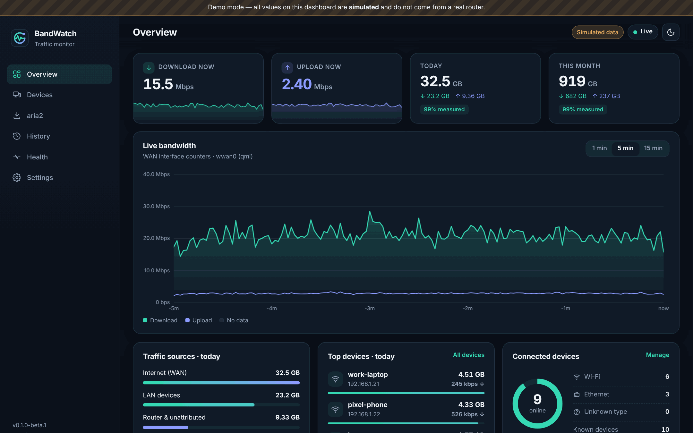
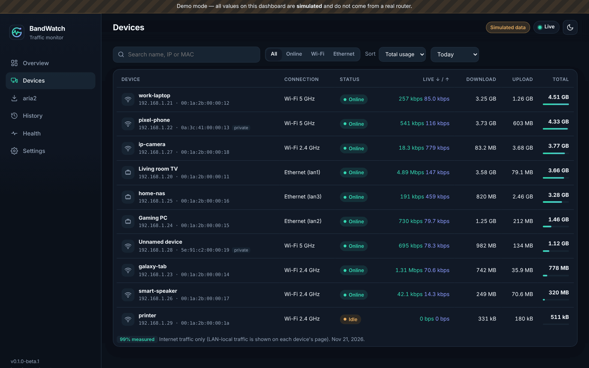
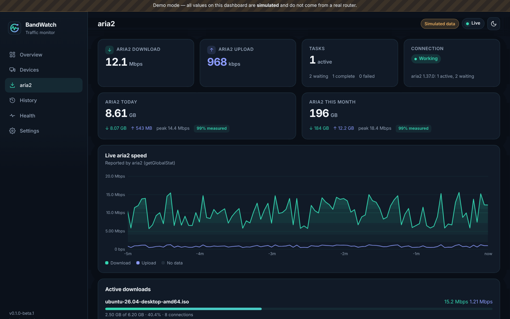
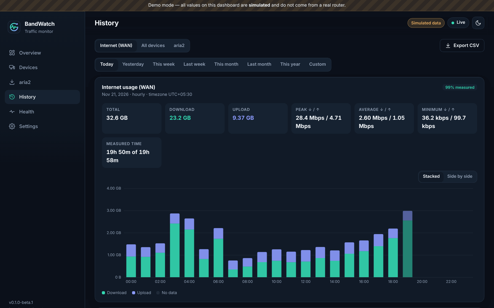
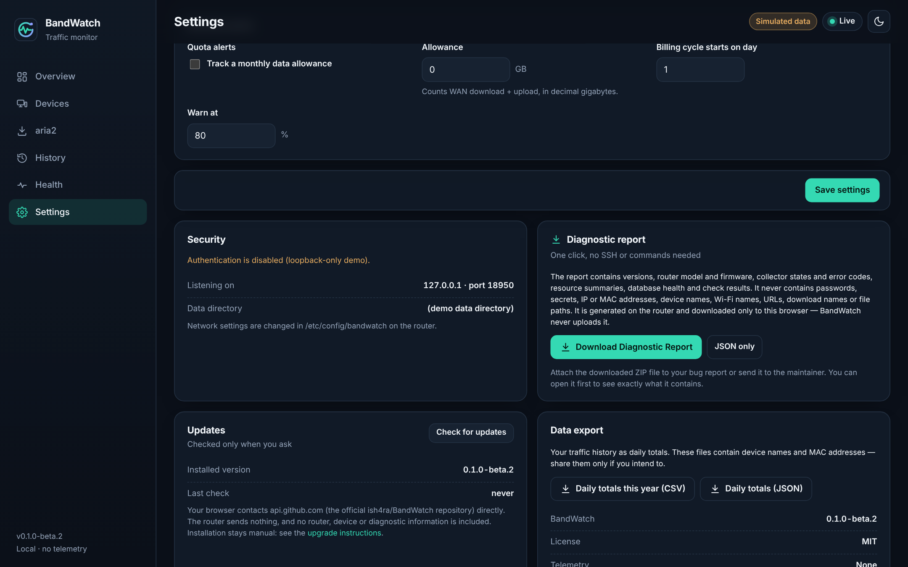
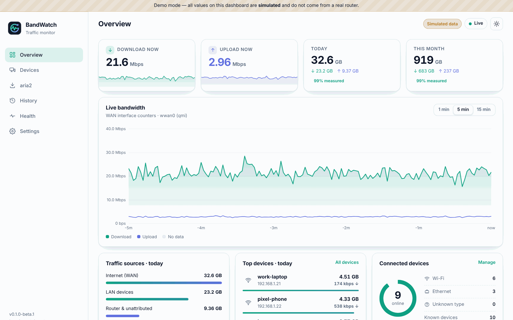
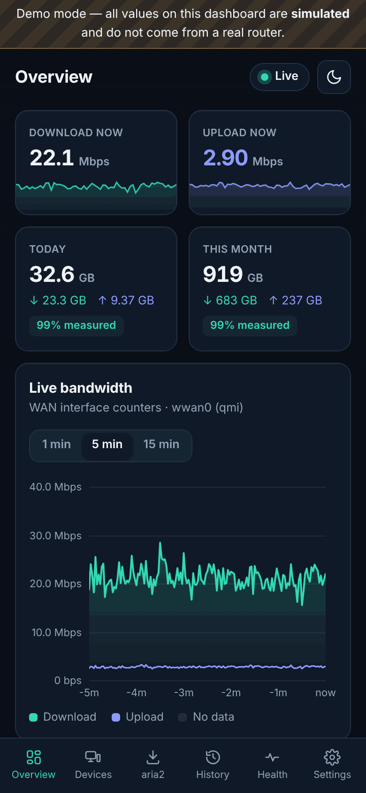
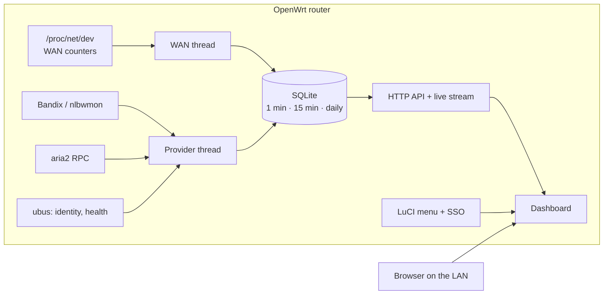

<div align="center">

<picture>
  <source media="(prefers-color-scheme: dark)" srcset="docs/assets/brand/wordmark-on-dark.svg">
  
</picture>

### Know your network. Every byte.

BandWatch is a lightweight, local-first network intelligence dashboard for OpenWrt routers. It combines real-time bandwidth monitoring, per-device analytics, aria2 transfer statistics and router health in one interface.

[](https://github.com/ish4ra/BandWatch/releases)
[](https://github.com/ish4ra/BandWatch/actions/workflows/ci.yml?query=branch%3Amain)
[](docs/COMPATIBILITY.md)
[](LICENSE)
[](https://github.com/ish4ra/BandWatch/releases)

[**Download**](https://github.com/ish4ra/BandWatch/releases) · [**Install**](docs/INSTALL.md) · [**Upgrade**](docs/UPGRADE.md) · [**සිංහල**](docs/INSTALL-SINHALA.md) · [**Demo**](#demo-mode) · [**Known issues**](#known-limitations)

</div>

> [!IMPORTANT]
> **Public beta for early adopters.** Not production-ready. BandWatch passes automated tests, OpenWrt 25.12/24.10 container tests and an OpenWrt SDK build.
>
> **First physical router result (one diagnostic snapshot, not hardware acceptance):** on an Arcadyan AW1000 (OpenWrt 25.12.5, qualcommax/ipq807x) beta.1 installed and ran in production mode; all six collectors reported OK; Bandix 0.12.12 reported eight devices; aria2 RPC connectivity was observed; BandWatch used 0.6 % CPU and about 17.2 MiB RSS at that moment, with no application loop errors. Traffic-accounting accuracy, sustained performance, WAN isolation and reboot recovery have **not** been verified yet.
>
> The CI badge includes one known, accepted failure: intermittent Firefox automated-test stalls ([#2](https://github.com/ish4ra/BandWatch/issues/2)). All other checks pass.

<br>

<p align="center">
  
  <br><sub>Overview dashboard in demo mode. All values on every screenshot are simulated.</sub>
</p>

## Key features

| | |
| --- | --- |
| **Live WAN bandwidth** | Reads interface counters directly, about every 2 s. Detects Ethernet/fibre, PPPoE, 4G/5G cellular (QMI/MBIM/NCM) and multi-WAN, IPv4 and IPv6, without double counting tunnels or PPPoE underlay ports. |
| **Per-device usage** | Reads an existing [Bandix](https://github.com/timsaya/bandix) installation (read-only API) or nlbwmon. Internet and LAN-local traffic are kept separate. Without a provider, WAN monitoring keeps working. |
| **aria2 statistics** *(optional)* | Read-only JSON-RPC: live speeds, task status, Today and This month totals. Data that already existed when a task was first seen is never counted. |
| **History and analytics** | Today, yesterday, week, month, year and custom ranges, with totals, peak, average and minimum speeds, measurement coverage and CSV export. Missing data is shown as a gap, never as zero. |
| **Router health** | CPU, memory, storage, temperatures, uptime, collector status, database persistence status and BandWatch's own resource use, recorded automatically (last hour / 24 h / 7 / 30 days). |
| **One-click diagnostic report** | A sanitised ZIP (JSON + plain-text summary) from the Health or Settings page: versions, collector codes, resource summaries, restarts and reboots, database health and explicit passed / failed / warning / insufficient-data / not-tested / unavailable checks. No SSH needed, never uploaded. |
| **Manual update check** | Settings → Updates asks GitHub from your browser, only when you press the button. Installation stays manual. |
| **LuCI integration** | Status → BandWatch menu entry with single sign-on (requires LuCI write access). |
| **Private and secure** | LAN-only by default, no cloud, no telemetry, CSRF and CSP protection, unprivileged service user, optional HTTPS, sanitised diagnostics. |
| **Embedded-friendly** | Python standard library and SQLite only, batched flash writes, bounded memory, about 150 KiB of web assets with no CDN. |

## Screenshots

| Devices | aria2 |
| --- | --- |
|  |  |
| **History** | **System health** |
|  |  |
| **Diagnostic report and updates (Settings)** | |
|  | |
| **Light theme** | **Phone** |
|  |  |

<sub>Captured from the real dashboard in demo mode (`node scripts/screenshots.js`). Device names, addresses and downloads are simulated.</sub>

## Supported connections and integrations

| Area | Supported | Verification so far |
| --- | --- | --- |
| WAN types | Cellular QMI/MBIM (`wwan0`), Ethernet/fibre (DHCP/static), PPPoE, multi-WAN (mwan3) | Simulated and unit-tested |
| IP versions | IPv4 and IPv6 on the same WAN, without double counting | Unit-tested |
| Per-device providers | Bandix 0.12.x (recommended), nlbwmon | Fixtures and simulation; Bandix rx/tx direction to be confirmed on hardware |
| Downloads | aria2 1.35+ JSON-RPC (optional) | Simulated and unit-tested |
| Cross-check | vnStat 2.x (on request) | Fixture-tested |
| Router UI | LuCI 25.12 menu and single sign-on | End-to-end in a real LuCI container |

## Requirements and compatibility

| Item | Requirement |
| --- | --- |
| OpenWrt | **25.12** (apk) or **24.10** (opkg). Older releases are untested. |
| Python | `python3-light`, `python3-sqlite3`, `python3-urllib` (3.10+, about 6–8 MB of flash); `python3-openssl` optional |
| Storage / RAM | About 3 MB for BandWatch plus a database of a few MB; at least 128 MB RAM recommended |
| Per-device data | Bandix or nlbwmon installed separately (optional) |
| Browser | A Chromium-based browser (Chrome, Edge, Brave) or Safari is recommended for this beta; see [#2](https://github.com/ish4ra/BandWatch/issues/2) for Firefox |

How each part has been verified:

| Level | What it covers | Status |
| --- | --- | --- |
| Automated unit and integration tests | Backend (Python 3.10, 3.11, 3.13), security and lint checks, dashboard end-to-end tests (Chromium, WebKit) | ✅ Passing |
| Firefox end-to-end tests | Same dashboard suite in Firefox | ⚠️ Intermittent harness stalls ([#2](https://github.com/ish4ra/BandWatch/issues/2)) |
| OpenWrt container tests | Install, service, ubus ACL, SSO, HTTPS, upgrade, rollback, uninstall, purge safety, tester helper on 25.12 and 24.10 rootfs; real LuCI end-to-end | ✅ Passing |
| OpenWrt SDK build | Feed Makefiles built with the 25.12 SDK | ✅ Passing |
| **Physical router** | Arcadyan AW1000 (qualcommax/ipq807x), OpenWrt 25.12.5 | ⏳ **Not yet tested** |

The full matrix is in [docs/COMPATIBILITY.md](docs/COMPATIBILITY.md).

## Download and installation

Get everything from the **[v0.1.0-beta.1 release page](https://github.com/ish4ra/BandWatch/releases/tag/v0.1.0-beta.1)**. No GitHub account is needed.

| File | Use it for |
| --- | --- |
| [`bandwatch-0.1.0-beta.1-tester-bundle.zip`](https://github.com/ish4ra/BandWatch/releases/download/v0.1.0-beta.1/bandwatch-0.1.0-beta.1-tester-bundle.zip) | **Hardware testers:** packages, guides (English and Sinhala), checklist and test-round helper |
| [`bandwatch-0.1.0-beta.1-openwrt.tar.gz`](https://github.com/ish4ra/BandWatch/releases/download/v0.1.0-beta.1/bandwatch-0.1.0-beta.1-openwrt.tar.gz) | **Recommended installer** with checks, backup and automatic rollback |
| `bandwatch-0.1.0_beta1-r1.apk`, `luci-app-bandwatch-0.1.0_beta1-r1.apk` | OpenWrt 25.12 package manager (alternative) |
| `bandwatch_0.1.0-beta1-1_all.ipk`, `luci-app-bandwatch_0.1.0-beta1-1_all.ipk` | OpenWrt 24.10 package manager (alternative) |
| [`SHA256SUMS`](https://github.com/ish4ra/BandWatch/releases/download/v0.1.0-beta.1/SHA256SUMS) | Integrity check for all of the above |

Packages are **unsigned** for this beta. Verify downloads with `sha256sum -c SHA256SUMS --ignore-missing` (Linux/macOS) or `Get-FileHash <file>` (Windows PowerShell).

## Quick start

```sh
# 1. On your computer: copy the installer to the router
scp -O bandwatch-0.1.0-beta.1-openwrt.tar.gz root@192.168.1.1:/tmp/

# 2. On the router (ssh root@192.168.1.1)
cd /tmp && tar -xzf bandwatch-0.1.0-beta.1-openwrt.tar.gz && cd bandwatch-0.1.0-beta.1
sh install.sh --dry-run     # read-only checks, changes nothing
sh install.sh               # installs, starts and prints a password
```

Open **LuCI → Status → BandWatch**, or `http://<router-ip>:8787/` with the printed password. To remove BandWatch, run `sh uninstall.sh` (keeps history) or `sh uninstall.sh --purge` (deletes it, but only from a verified BandWatch data folder). Details are in [INSTALL.md](docs/INSTALL.md); the Sinhala guide is [INSTALL-SINHALA.md](docs/INSTALL-SINHALA.md).

## Demo mode

No router needed. The demo simulates an OpenWrt router (cellular WAN, Wi-Fi and Ethernet clients, Bandix, aria2, vnStat) and labels every page as simulated:

```sh
python3 -m bandwatch demo                      # http://127.0.0.1:8787/
python3 -m bandwatch demo --scenario pppoe     # 13 scenarios, see --help
```

## Architecture



One Python process (standard library only) runs as an unprivileged user. WAN sampling has its own thread, so slow providers cannot delay it. Samples are rolled up into tiered SQLite tables and written in batches to limit flash wear. All provider access is read-only and loopback-only by default. See [ARCHITECTURE.md](docs/ARCHITECTURE.md).

## Performance

Targets on the router are **below 2 % average idle CPU and below 30 MiB resident memory**. Sustained averages on router hardware have **not yet been measured**; from beta.2 on BandWatch records them itself and includes them in the diagnostic report.

| Environment | CPU | Memory (RSS) |
| --- | --- | --- |
| **Arcadyan AW1000 (physical), production, one snapshot minutes after boot** | 0.6 % | ~17.2 MiB |
| Development VM, demo mode, idle | 0.07–0.13 % | 27.2–27.3 MiB |
| Development VM, demo mode, 4 live dashboards | 0.67–0.73 % | 28.8–29.1 MiB |
| OpenWrt 25.12 container, production mode, idle | 0.18 % | 24.8 MiB |

The AW1000 figure is a single reading, not an idle benchmark or an average. See [PERFORMANCE.md](docs/PERFORMANCE.md).

## Security and privacy

- **Local only.** No telemetry, no account, no cloud. The only connections are to the Bandix and aria2 endpoints you configure, on the router by default.
- **LAN-only by default.** The dashboard listens on the LAN address and loopback. The tester helper verifies this locally, which matters behind CGNAT, where an outside test proves nothing.
- **Hardened.** Password or LuCI sign-on, CSRF protection, strict CSP, rate-limited login, unprivileged service user, optional HTTPS, write-only aria2 secret.
- **Shareable reports.** The diagnostic report is built from an explicit allow-list: no MAC/IP addresses, host, device or Wi-Fi names, credentials, URLs, file paths, download names or provider messages. It is generated on the router and only downloaded by your browser.

See [SECURITY.md](SECURITY.md) and the [security audit](docs/SECURITY-AUDIT.md).

## Known limitations

- **Physical-router verification is incomplete.** One AW1000 snapshot confirms installation and provider connectivity; traffic accuracy, sustained CPU/memory, Bandix rx/tx direction, WAN isolation and reboot recovery still have to be confirmed.
- **Per-device monitoring needs a provider** (Bandix or nlbwmon). Without one, only WAN totals are available.
- **Hardware or software flow offloading** can bypass the counters some providers rely on, so per-device totals may be lower than the WAN total.
- **aria2 history is an estimate** of payload traffic. Downloads that start and finish between two polls are reported as "not counted".
- **Firefox**: automated tests stall intermittently ([#2](https://github.com/ish4ra/BandWatch/issues/2)). Firefox is not verified for this beta; use a Chromium-based browser or Safari.
- **Unsigned packages.** Verify `SHA256SUMS` before installing.
- **Plain HTTP by default.** HTTPS with a self-signed certificate is optional.

## Documentation

| Document | Contents |
| --- | --- |
| [INSTALL.md](docs/INSTALL.md) | Installation, upgrade, uninstall, hardware test round |
| [INSTALL-SINHALA.md](docs/INSTALL-SINHALA.md) | සිංහල ස්ථාපන සහ පරීක්ෂණ මාර්ගෝපදේශය |
| [UPGRADE.md](docs/UPGRADE.md) / [UPGRADE-SINHALA.md](docs/UPGRADE-SINHALA.md) | Upgrading from beta.1 without losing data; one-click report (English / සිංහල) |
| [HARDWARE-TESTING.md](docs/HARDWARE-TESTING.md) | Acceptance checklist for physical routers |
| [COMPATIBILITY.md](docs/COMPATIBILITY.md) | Platforms, providers and verification levels |
| [TROUBLESHOOTING.md](docs/TROUBLESHOOTING.md) | Common problems and diagnostics |
| [ARCHITECTURE.md](docs/ARCHITECTURE.md) | Design, providers, analytics definitions, storage |
| [PERFORMANCE.md](docs/PERFORMANCE.md) | Measurements and router targets |
| [SECURITY-AUDIT.md](docs/SECURITY-AUDIT.md) | Pre-beta audit findings and fixes |
| [REQUIREMENTS-TRACEABILITY.md](docs/REQUIREMENTS-TRACEABILITY.md) | Requirements → code → tests |
| [DEVELOPMENT.md](docs/DEVELOPMENT.md) | Building, testing, demo scenarios, CI |
| [CHANGELOG.md](CHANGELOG.md) | Release history |

## Contributing

Bug reports from real routers are the most valuable contribution right now. Please use the **Hardware test report** or bug report templates under [Issues](https://github.com/ish4ra/BandWatch/issues), and attach the ZIP from **Health → Download Diagnostic Report** (or, for full acceptance testing, the output of `bandwatch-test-round.sh`). Code contributions are welcome; see [CONTRIBUTING.md](CONTRIBUTING.md). Report security issues privately as described in [SECURITY.md](SECURITY.md).

## License

[MIT](LICENSE) © BandWatch contributors. BandWatch is independent of and not affiliated with OpenWrt, Bandix, nlbwmon, vnStat or aria2; it only reads their public interfaces.
