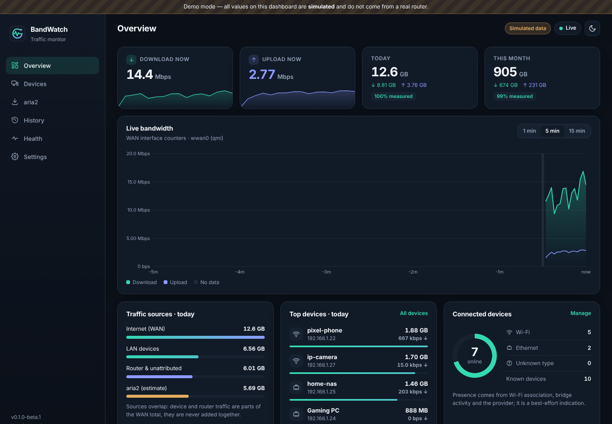
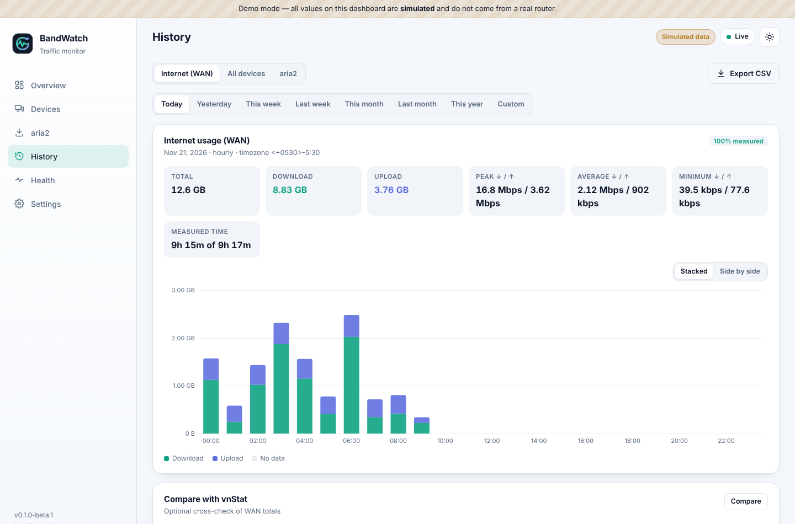
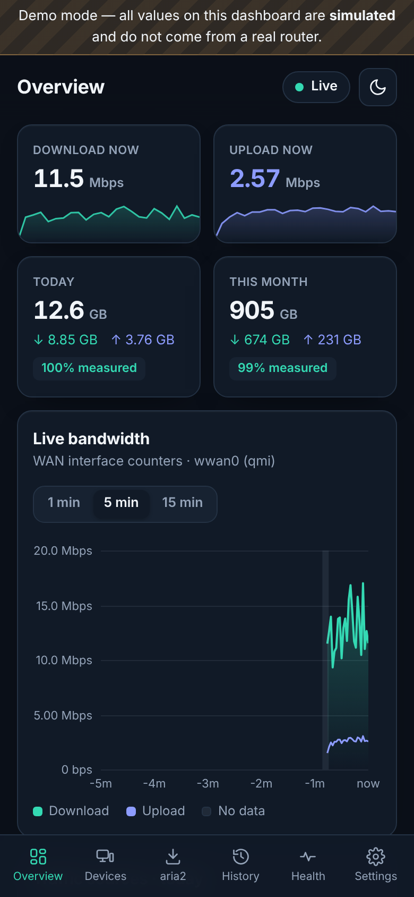

<p align="center"></p>

<p align="center"><b>Lightweight, privacy-focused network traffic monitoring for OpenWrt routers.</b><br>
WAN usage · per-device usage · aria2 downloads · router health — all local, no cloud, no telemetry.</p>

<p align="center">


</p>

> **Beta software (v0.1.0-beta.1).** It has passed automated tests and OpenWrt
> container tests, but **has not yet been verified on physical router
> hardware**. See [Compatibility](docs/COMPATIBILITY.md) and the
> [hardware testing checklist](docs/HARDWARE-TESTING.md).



## Features

- **Live WAN bandwidth** from Linux interface counters, with automatic WAN
  detection for Ethernet/fibre, PPPoE, 4G/5G cellular (QMI/MBIM/NCM) and
  multi-WAN, IPv4 and IPv6, without double counting tunnels (6in4, CLAT,
  WireGuard) or PPPoE underlay ports.
- **Per-device usage** via an existing [Bandix](https://github.com/timsaya/bandix)
  installation (read-only API) or nlbwmon, with Internet and LAN-local
  traffic kept separate. Without a provider, WAN monitoring keeps working and
  the dashboard explains what is missing.
- **aria2 integration** (optional, read-only JSON-RPC): live speeds, task
  status, and transfer history that never counts pre-existing file data.
- **History**: today, yesterday, this/last week, this/last month, this year
  and custom ranges, with totals, peak/average/minimum speeds, measurement
  coverage and CSV export. Missing data is shown as a gap, never as zero.
- **Router health**: CPU, memory, storage, temperature, uptime, BandWatch's
  own resource use, collector and database status, and the database size
  separately from filesystem usage.
- **Quota tracking** with a configurable billing day and local alerts.
- **Premium responsive dashboard**: dark (default) / light / system themes,
  phone/tablet/desktop layouts, keyboard accessible, reduced-motion aware,
  installable as a PWA over HTTPS. No CDN, no remote fonts, ~150 KiB total.
- **Secure by default**: LAN-only binding, password or LuCI single sign-on,
  CSRF protection, strict CSP, unprivileged service account, sanitised
  diagnostics.
- **Embedded-friendly**: Python standard library only, SQLite with tiered
  roll-ups, batched flash writes, bounded memory; WAN sampling runs on its
  own thread so slow providers cannot delay it. Measured 25–29 MiB RSS and
  0.1–0.2 % CPU idle on x86 (see [PERFORMANCE.md](docs/PERFORMANCE.md));
  router figures are still to be measured.

| History (light theme) | Phone |
| --- | --- |
|  |  |

*Screenshots show the built-in demo mode; all values are simulated.*

## Quick start (router)

Requirements: OpenWrt 24.10 or 25.12 with `python3-light`, `python3-sqlite3`
and `python3-urllib` (the installer can add them with `--install-deps`).

```sh
# on your computer
scp -O bandwatch-0.1.0-beta.1-openwrt.tar.gz root@192.168.1.1:/tmp/
# on the router
cd /tmp && tar -xzf bandwatch-0.1.0-beta.1-openwrt.tar.gz && cd bandwatch-0.1.0-beta.1
sh install.sh --dry-run     # read-only checks, changes nothing
sh install.sh               # installs, starts and prints a password
```

Then open `http://<router-ip>:8787/` or **LuCI → Status → BandWatch**.
Package installation (`apk add --allow-untrusted bandwatch-*.apk` on 25.12,
`opkg install bandwatch_*.ipk` on 24.10) is described in
[docs/INSTALL.md](docs/INSTALL.md). A Sinhala guide for testers is in
[docs/INSTALL-SINHALA.md](docs/INSTALL-SINHALA.md).

## Quick start (development / demo)

No router needed — the demo mode simulates an OpenWrt router (AW1000-style
cellular WAN, Wi-Fi/Ethernet clients, Bandix, aria2, vnStat) and labels every
page as simulated.

```sh
python3 -m bandwatch demo                      # http://127.0.0.1:8787/
python3 -m bandwatch demo --scenario pppoe     # see --help for all scenarios
python3 -m pytest                              # backend tests
```

See [docs/DEVELOPMENT.md](docs/DEVELOPMENT.md).

## Documentation

| Document | Contents |
| --- | --- |
| [INSTALL.md](docs/INSTALL.md) | Beginner-friendly installation, upgrade, uninstall |
| [INSTALL-SINHALA.md](docs/INSTALL-SINHALA.md) | සිංහල ස්ථාපන සහ පරීක්ෂණ මාර්ගෝපදේශය |
| [ARCHITECTURE.md](docs/ARCHITECTURE.md) | Design, data providers, analytics definitions, storage |
| [COMPATIBILITY.md](docs/COMPATIBILITY.md) | Tested / untested platforms and providers |
| [HARDWARE-TESTING.md](docs/HARDWARE-TESTING.md) | Acceptance checklist for physical routers |
| [TROUBLESHOOTING.md](docs/TROUBLESHOOTING.md) | Common problems and diagnostics |
| [DEVELOPMENT.md](docs/DEVELOPMENT.md) | Building, testing, demo scenarios, CI |
| [REQUIREMENTS-TRACEABILITY.md](docs/REQUIREMENTS-TRACEABILITY.md) | Every requirement → code → tests, with verification level |
| [SECURITY-AUDIT.md](docs/SECURITY-AUDIT.md) | Pre-beta security audit findings and fixes |
| [PERFORMANCE.md](docs/PERFORMANCE.md) | Measured resource use (dev machine) vs router targets |
| [SECURITY.md](SECURITY.md) | Security model and vulnerability reporting |
| [CHANGELOG.md](CHANGELOG.md) | Release notes |

## Privacy

BandWatch runs entirely on your router. It has no telemetry, makes no
outbound connections (only to local Bandix/aria2 endpoints you configure),
and needs no account. Diagnostics exports remove MAC/IP addresses,
hostnames, file names and secrets.

## License

[MIT](LICENSE). BandWatch is independent of and not affiliated with Bandix,
vnStat, aria2 or OpenWrt; it only reads their public interfaces.
