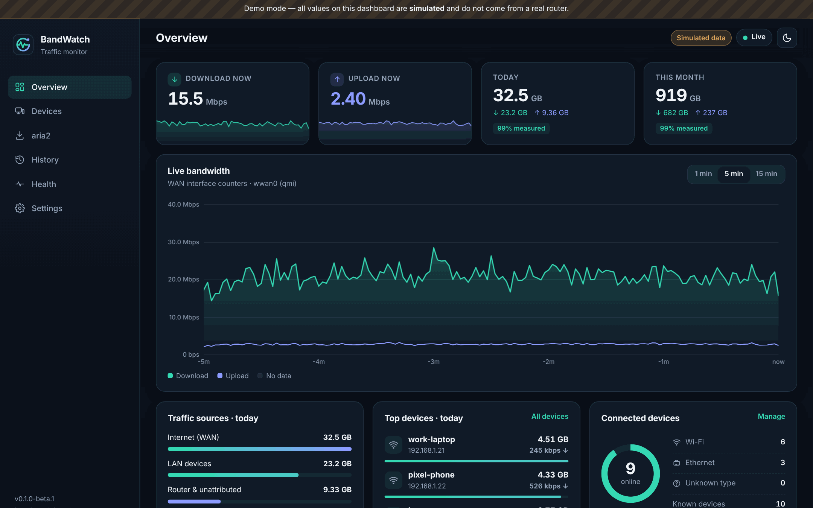
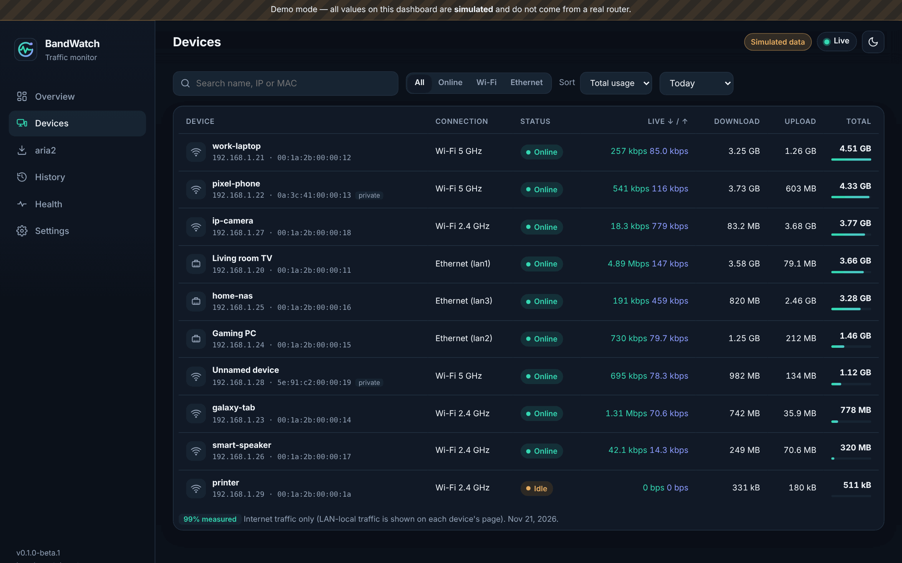
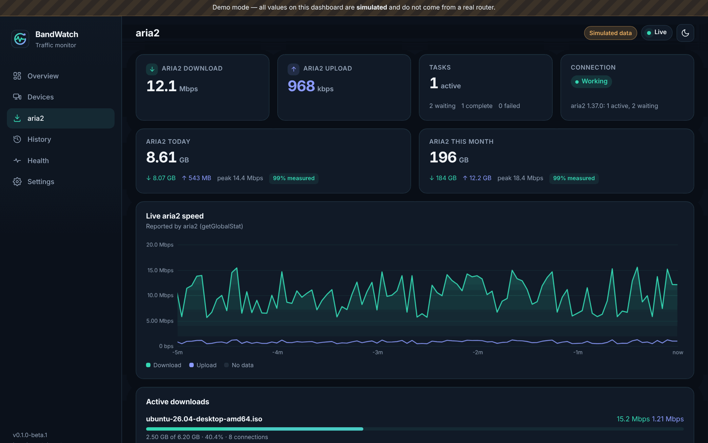
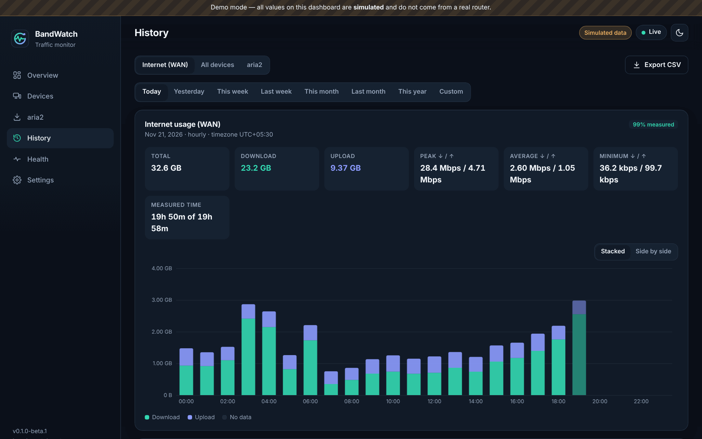

<p align="center"></p>

**BandWatch** is a lightweight, local-first network intelligence dashboard for OpenWrt routers. It combines real-time bandwidth monitoring, per-device analytics, aria2 transfer statistics and router health in one interface. It runs on the router, needs no cloud service or account, and sends no telemetry.

> [!WARNING]
> **This is the first public beta, intended for early adopters and physical-router testing.** It is **not production-ready**. Everything passed automated tests, OpenWrt container tests and an OpenWrt SDK build. **No physical router has been tested yet**; the first hardware test (Arcadyan AW1000, OpenWrt 25.12.5) is pending.

## Highlights

- **Live WAN bandwidth** from interface counters (about 2 s), with automatic detection of Ethernet/fibre, PPPoE, 4G/5G cellular and multi-WAN, IPv4 and IPv6, without double counting.
- **Per-device usage** through an existing Bandix (recommended) or nlbwmon installation, with Internet and LAN-local traffic kept separate.
- **aria2 statistics** (optional, read-only): live speeds, tasks, and Today and This month totals.
- **History**: today to this year plus custom ranges, with peak, average and minimum speeds, coverage and CSV export. Gaps are shown as gaps, never as zero.
- **Router health**: CPU, memory, storage, temperatures, collector status and BandWatch's own footprint.
- **LuCI integration** with single sign-on, **optional HTTPS**, and dark, light and system themes on phone, tablet and desktop.
- **Safe installer** with dry run, backup and automatic rollback; uninstall keeps data unless you purge, and purge only deletes a verified BandWatch data folder.

| Devices | aria2 | History |
| --- | --- | --- |
|  |  |  |

<sub>Screenshots are from the real dashboard in demo mode; all values are simulated.</sub>

## Requirements

- OpenWrt **25.12** (apk) or **24.10** (opkg). Older releases are untested.
- `python3-light`, `python3-sqlite3`, `python3-urllib` (the installer can add them with `--install-deps`).
- For per-device data: Bandix or nlbwmon, installed separately. aria2 and vnStat are optional.
- For the dashboard: a Chromium-based browser (Chrome, Edge, Brave) or Safari. See the Firefox note below.

## Downloads

| Asset | Use it for |
| --- | --- |
| `bandwatch-0.1.0-beta.1-tester-bundle.zip` | **Hardware testers**: all packages, English and Sinhala guides, README-FIRST, hardware checklist, test-round helper (pre-reboot and post-reboot reports) |
| `bandwatch-0.1.0-beta.1-openwrt.tar.gz` | **Recommended installer** (checks, backup, automatic rollback) |
| `bandwatch-0.1.0_beta1-r1.apk`, `luci-app-bandwatch-0.1.0_beta1-r1.apk` | OpenWrt 25.12 package manager |
| `bandwatch_0.1.0-beta1-1_all.ipk`, `luci-app-bandwatch_0.1.0-beta1-1_all.ipk` | OpenWrt 24.10 package manager |
| `SHA256SUMS` | Checksums of every asset above |

Packages are **unsigned**, so verify your downloads: run `sha256sum -c SHA256SUMS --ignore-missing` on Linux, or `Get-FileHash <file>` in Windows PowerShell and compare with `SHA256SUMS`. Everything was built by the release workflow from the tagged `main` commit.

## Recommended installation

```sh
scp -O bandwatch-0.1.0-beta.1-openwrt.tar.gz root@192.168.1.1:/tmp/     # on your computer
cd /tmp && tar -xzf bandwatch-0.1.0-beta.1-openwrt.tar.gz && cd bandwatch-0.1.0-beta.1   # on the router
sh install.sh --dry-run
sh install.sh
```

Then open **LuCI → Status → BandWatch**. Full guides: [English](https://github.com/ish4ra/BandWatch/blob/main/docs/INSTALL.md) · [සිංහල](https://github.com/ish4ra/BandWatch/blob/main/docs/INSTALL-SINHALA.md).

**Hardware testers:** follow `README-FIRST.txt` in the tester bundle. Copy the pre-reboot report to your computer **before** rebooting (`/tmp` is cleared by a reboot), then run the separate post-reboot step.

## Security and privacy

- Local only: no telemetry, no account, no outbound connections except the Bandix and aria2 endpoints you configure (on the router by default).
- LAN-only by default, password or LuCI single sign-on, CSRF protection, strict CSP, unprivileged service user, optional HTTPS.
- Diagnostics and tester reports remove MAC/IP addresses, host, device and Wi-Fi names, credentials and download file names.
- Details: [SECURITY.md](https://github.com/ish4ra/BandWatch/blob/main/SECURITY.md) · [security audit](https://github.com/ish4ra/BandWatch/blob/main/docs/SECURITY-AUDIT.md).

## Known limitations

- **No physical-router verification yet.** CPU and memory on ARM, Bandix rx/tx direction and WAN isolation are still to be confirmed. Measured so far only on x86-64: 24.8–29.1 MiB RSS and 0.07–0.73 % CPU ([PERFORMANCE.md](https://github.com/ish4ra/BandWatch/blob/main/docs/PERFORMANCE.md)).
- **Per-device monitoring needs Bandix or nlbwmon.** **Flow offloading** can make per-device totals lower than the WAN total.
- **aria2 history is an estimate** of payload traffic.
- **Firefox**: the automated Firefox test job fails intermittently, with page loads stalling after cancelled requests under Playwright ([#2](https://github.com/ish4ra/BandWatch/issues/2)). It is the only failing CI check and was accepted as a release exception. **Firefox is not verified**; use a Chromium-based browser or Safari for this beta.
- **Unsigned packages**; verify `SHA256SUMS`.
- Plain HTTP by default (HTTPS optional).

## Reporting bugs

Please open an issue with the **Hardware test report** or **Bug report** template: https://github.com/ish4ra/BandWatch/issues/new/choose. Attach the sanitised `bandwatch-test-round.sh` reports or `bandwatch-diag` output, and review them before sharing. Report security problems privately as described in [SECURITY.md](https://github.com/ish4ra/BandWatch/blob/main/SECURITY.md).

## Uninstall

```sh
cd /tmp/bandwatch-0.1.0-beta.1    # re-extract the archive if a reboot removed it
sh uninstall.sh                   # removes the program, keeps history and settings
sh uninstall.sh --purge           # also deletes BandWatch data (verified data folder only)
```

Package installs: `apk del luci-app-bandwatch bandwatch` (25.12) or `opkg remove luci-app-bandwatch bandwatch` (24.10).

Full changelog: [CHANGELOG.md](https://github.com/ish4ra/BandWatch/blob/main/CHANGELOG.md)
