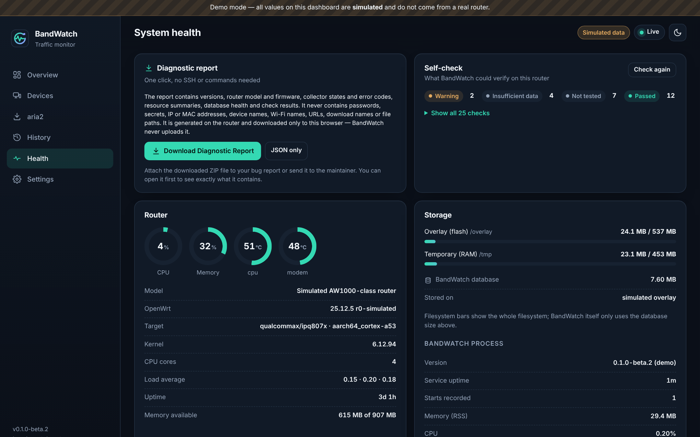

**BandWatch 0.1.0-beta.2** focuses on reliability, automatic local diagnostics and a safe upgrade from beta.1. It is still a beta for early adopters and is **not production-ready**.

> [!NOTE]
> **First physical router result (one diagnostic snapshot, not hardware acceptance).** beta.1 was installed on an Arcadyan AW1000 (OpenWrt 25.12.5, qualcommax/ipq807x) and ran in production mode. All six collectors reported OK, Bandix 0.12.12 reported eight devices, aria2 RPC connectivity was observed, BandWatch used 0.6 % CPU and about 17.2 MiB RSS at that moment, and there were no application loop errors. Traffic-accounting accuracy, sustained performance, WAN isolation and reboot recovery have **not** been verified yet.

## Upgrading from beta.1

No uninstall, nothing lost: history, settings, aliases, password, aria2 settings, retention and LuCI integration are kept. Run the new installer the same way as the first install, or upgrade the apk/ipk packages in place. The database format is unchanged, so going back to beta.1 keeps your data too. Guides: [English](https://github.com/ish4ra/BandWatch/blob/main/docs/UPGRADE.md) · [සිංහල](https://github.com/ish4ra/BandWatch/blob/main/docs/UPGRADE-SINHALA.md).

Tested in CI against the **published** beta.1 code and packages: installer upgrade, apk upgrade (OpenWrt 25.12), opkg upgrade (24.10), rollback to beta.1 and re-upgrade.

## Highlights

- **One-click diagnostic report.** Health or Settings → *Download Diagnostic Report*: a ZIP with a versioned JSON report and a plain-text summary. No SSH, scripts or reboot. Each check is *passed*, *failed*, *warning*, *insufficient data*, *not tested* or *unavailable*, and untested conditions are listed explicitly.
- **Privacy by allow-list.** The report contains versions, model and firmware, collector codes, resource summaries, restarts/reboots, database health and check results. It never contains passwords, secrets, IP or MAC addresses, device or Wi-Fi names, URLs, file paths, download names or provider messages, and BandWatch never uploads it.
- **Automatic health monitoring** from the first start: BandWatch CPU, memory and threads, sampling delays, collector errors, restarts and router reboots, summarised for the last hour, 24 hours, 7 and 30 days. Bounded memory, no extra flash writes.
- **Clear persistence status.** Health shows service uptime, last successful save, time to the next save and unsaved data, and says plainly when an empty history is the normal start-up state.
- **Reliability fixes.** Samples gathered before the router clock is trusted are no longer lost on a restart in the first minutes after boot; the first save comes 90 s after the clock is trusted; a clean stop checkpoints the database.
- **Better Bandix direction check.** Ignores router-generated traffic (aria2, updates) and ambiguous samples, shows its progress, and never swaps the setting by itself.
- **Manual update check** in Settings, run by your browser only when you press the button.

## Known issues

- Firefox: the root cause of the intermittent CI failure is in the test tooling (Playwright's Firefox driver loses page-load events while the page loads normally); regular Firefox loaded every view in 300 automated new-tab loads. The Playwright Firefox job can still fail intermittently ([#2](https://github.com/ish4ra/BandWatch/issues/2)). Chromium-based browsers and Safari remain recommended for this beta.
- Packages are unsigned unless the maintainer configures a signing key; verify `SHA256SUMS`.

Full list of changes: [CHANGELOG.md](https://github.com/ish4ra/BandWatch/blob/main/CHANGELOG.md).
